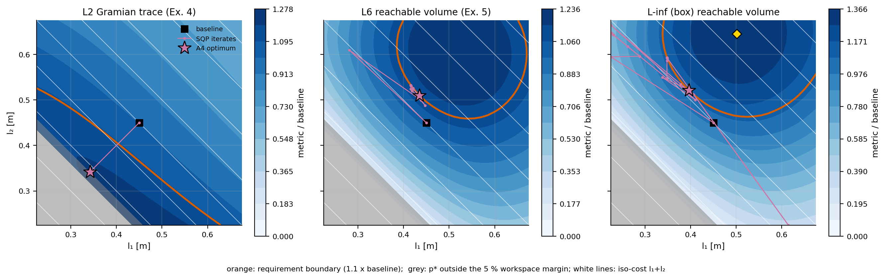
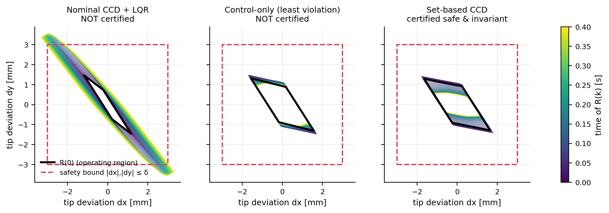

# Morphology–control co-design of a planar arm: reachability and set-based studies

This repository applies two recent design-optimization methods to one robot,
a planar two-link arm whose **link lengths are design variables**:

| Folder | Reproduces | Question about the arm | Controller in the loop? |
|---|---|---|---|
| [`study_A_reachability_design/`](study_A_reachability_design/) | Nguyen, Cortés & Kramer, *Reachability Analysis for Design Optimization*, ACC 2026 | Which is the cheapest arm whose tool tip can reach ≥ 10 % more task-space states in 0.5 s? | No (controller-agnostic, open-loop reachable sets) |
| [`study_B_set_based_ccd/`](study_B_set_based_ccd/) | Bird, Siefert, Pangborn & Jain, *A Set-Based Approach for Robust Control Co-Design*, ACC 2024 | Which arm and feedback gain keep the tip within ±3 mm for **every** bounded contact force, within the torque limits? | Yes (closed-loop reachable tubes, robust invariance certificate) |

Each folder has its own README covering the mapping from the paper, the
equations, every figure and the results. This page covers the shared plant,
how to run everything, and a summary.

---

## 1. The shared system

```
            y
            ^          p* = (0.55, 0.35) m   <- tool held here, F_ext acts here
            |        o
            |   l2  /
            |      /  q2
            |     o  (elbow motor, 0.4 kg)
            |    / l1
            |   / q1
   base ->  [#]-------------------> x        horizontal plane (SCARA type):
                                              gravity acts along the joint axes
```

[`common/arm.py`](common/arm.py) defines a planar serial arm with:

| Quantity | Value |
|---|---|
| Link i | uniform rod, mass 2.0 kg/m × lᵢ, inertia mᵢlᵢ²/12 |
| Elbow motor / tip payload | 0.4 kg point mass at the elbow / 0.25 kg at the tip |
| Joint damping (geared motor back-EMF) | c = 4.0 N·m·s/rad |
| Torque limits (shoulder, elbow) | 1.0, 0.5 N·m |
| Baseline morphology | l = (0.45, 0.45) m |

The nonlinear dynamics are M(q)q̈ + C(q, q̇)q̇ + Dq̇ = τ + J(q)ᵀF_ext. The arm
holds the tool at a fixed work point p\*, so its posture q₀(l) comes from
inverse kinematics and changes when the link lengths change. The
linearization about (q₀, 0) is exact to first order, because the Coriolis
term is quadratic in q̇:

```
x = [Δq; Δq̇],   ẋ = A(l) x + B(l) τ + E(l) F_ext
A = [[0, I], [0, −M₀⁻¹D]],   B = [0; M₀⁻¹],   E = [0; M₀⁻¹J₀ᵀ]
task outputs: Δp_tip = J₀ Δq,   Δṗ_tip = J₀ Δq̇
```

Three quantities that drive both studies all depend on l: the inertia M₀,
the Jacobian J₀ and the posture q₀. The nonlinear model
(`simulate_nonlinear`, `simulate_nonlinear_sampled`) is used to check both
studies' linear predictions.

**Why this system (and not the previous hanging N-link chain).** The two
papers need specific structure:
* a 4-state, 2-input LTI plant with two design variables (the F-16 example);
* a planar single-input case with real eigenvalues (Theorem 2);
* a plant with a bounded additive disturbance, a safety set and a feedback
  law (the suspension example).

The horizontal two-link arm provides all of these. The one-link version has
eigenvalues {0, −c/I}, so Theorem 2 applies exactly. The tip is a real 2-D
task-space output with physical units. Motor back-EMF creates a genuine
trade-off between short (light) and long (lever) links. §5 lists why the
previous set-up could not reproduce the papers.

## 2. Repository layout

```
README.md                         this file
requirements.txt
common/
  arm.py                          plant: kinematics, inertia, IK, linearization, nonlinear simulation
  style.py                        figure style
study_A_reachability_design/
  README.md                       method, mapping to the paper, results
  reachability.py                 Lemma 1, Prop 1, Thm 2, Thm 3, Prop 2, zonotope, metrics
  run_study.py                    experiments A1–A7 -> figures/, results/summary.json
study_B_set_based_ccd/
  README.md
  setbased.py                     zonotope tubes, Algorithm 1, Proposition 1, Problem (24)
  run_study.py                    3 designs + validation -> figures/, results/summary.json
```

## 3. Running

```bash
python3 -m venv opt-env && source opt-env/bin/activate
pip install -r requirements.txt

python study_A_reachability_design/run_study.py   # about 9 min
python study_B_set_based_ccd/run_study.py         # about 6 min
```

Each script is self-contained and deterministic (fixed seeds and Sobol
directions). It overwrites its own `figures/*.png` and
`results/summary.json`. Study parameters are constants at the top of each
`run_study.py` and in `setbased.Setup`.

## 4. Results at a glance

**Study A: open-loop reachability (Nguyen–Cortés–Kramer).**
Problem: min l₁ + l₂ subject to metric ≥ 1.1 × baseline (baseline 0.45/0.45 m).

| Requirement | Optimal l₁, l₂ [m] | Cost change | Side effect |
|---|---|---|---|
| L² Gramian trace (paper Ex. 4) | 0.342, 0.342 | −23.9 % | near-singular posture; box-input volume falls to 0.17× |
| L⁶ volume (paper Ex. 5) | 0.435, 0.509 | +4.9 % | box volume 1.15× |
| L∞ (true torque box) volume | 0.396, 0.521 | +1.9 % | none (the physically relevant answer) |
| maximize L∞ volume | 0.501, 0.646 | +27.4 % | volume 1.37× (interior optimum) |

The exact planar theory (Theorem 2, Prop. 1) is verified on the one-link
arm to 4 significant figures. The two-link arm switches up to twice, so the
planar theory does not extend to it. Bang-bang extremals replayed on the
nonlinear arm match the linear set to about 6 %.



**Study B: robust set-based co-design (Bird et al.).**
Problem: keep the tip within ±3 mm for every tip force in [−0.3, 0.3]² N,
within the torque limits, and re-enter the operating region (certified safe
for all time).

| Design | l₁, l₂ [m] | Worst tip error | Torque use | Certified |
|---|---|---|---|---|
| Nominal CCD + LQR (one scenario) | 0.385, 0.300 | 3.54 mm (> 3) | 31 % | no |
| Best controller on baseline arm | 0.450, 0.450 | 1.69 mm | 101 % | no |
| Set-based co-design | 0.472, 0.481 | 1.77 mm | 100 % | **yes** |

The nominal design handles its own scenario with 0.8 mm error, but a
worst-case force history (computed exactly) pushes it to 3.54 mm, which the
nonlinear arm confirms. 300 random force histories never exceeded 2.1 mm.
No gain makes the baseline morphology certifiable. Lengthening the links by
6 % and re-tuning K does.



## 5. What the previous version of this repository did, and why it was replaced

The previous code (in git history, `N-dof-arm/`; recover it with
`git checkout <commit> -- N-dof-arm`) contained these optimization cases:

1. **Capability maximization.** It optimized link lengths for N = 1…5 with
   fixed total length (4 m), mass (2 kg) and torque budget (2 N·m), using
   differential evolution per N. There were three criteria: the L² Gramian
   trace, the L⁶ area and the L∞ area of the output [x_EE, T·ẋ_EE] of a chain
   hanging under gravity.
2. **Minimum-cost targets.** It looked for the cheapest morphology reaching
   +5/10/20/30 % L∞ area, with cost J = w_L·L/L₀ + w_N·N/N₀.
3. **Task tracking.** A box-constrained tracking QP followed a sinusoidal
   x_EE reference, with link lengths re-optimized per N.
4. **Sensitivity and validation.** This covered fixed-per-joint versus
   fixed-total torque, raw versus peak-equivalent L^p norms, a one-link
   length sweep, norm and resolution convergence, costate sampling (N = 1, 2),
   an outer zonotope, and redistribution sampling.
5. **Legacy and retired.** Padded mixed-integer, "dual/bilevel/joint" JSON
   results, an identical-joint-angle objective, and a clipped LQT.

Problems found in that set-up:

* **Degenerate cost.** With total length fixed, the cost varies only with N.
  N = 1 is 85 % worse than the baseline, and *any* N = 2 redistribution
  already gains +617 %. All four targets (+5…30 %) were met by the baseline's
  own N, so the minimum-cost study had no trade-off. The papers' formulation
  (minimize a design cost subject to reachability ≥ 1.1 × baseline) needs a
  cost that conflicts with reachability.
* **Run-away objectives.** The L² trace gained +4991 % by pushing links to
  their 0.2 m bounds. The "N = 5" optima had three links at the lower bound,
  so they were effectively N = 2 arms. This is the lopsided-set failure the
  paper warns about for trace and volume metrics.
* **Limited output.** At the hanging equilibrium the vertical tip motion is
  second order, so only x_EE and ẋ_EE were visible. That set mixes position
  and velocity and is not a workspace.
* **Inconsistent task result.** The task-optimal morphology tracked *worse*
  in RMS (0.0092) than the reachability optimum (0.0080). SLSQP had been
  started from equal lengths, and the objective also contained effort.
* **No robust or closed-loop design.** Nothing corresponded to the
  set-based co-design paper.
* **Repository size.** 91 tracked files, including `.pyc` files, MP4s,
  compatibility wrappers and duplicated JSON and plots.

The new version keeps the useful ideas from the old one: support functions,
costate sampling, zonotopes and nested optimization. It fixes the plant and
the formulations so that each paper's study is reproduced faithfully, in
about 1,600 lines of code across 7 source files.

## 6. Assumptions and limitations (both studies)

* Rigid links and planar motion. Joint limits, motor dynamics and friction
  other than viscous damping are not modelled.
* The design analysis uses the linearization about the holding posture. Each
  study checks it against the nonlinear arm (Study A, A7; Study B, B4).
* Sets are computed for linear systems: inner hulls of sampled extremals
  (Study A) and exact discrete-time zonotopes (Study B). Optimizers are local
  SQP with finite differences. Study A cross-checks with a dense grid, and
  Study B uses multistart.
* Costs are dimensionless proxies (total link length), not hardware prices.

## References

1. S. Nguyen, J. Cortés, B. Kramer, "Reachability Analysis for Design
   Optimization," American Control Conference 2026.
   [arXiv:2603.15865](https://arxiv.org/abs/2603.15865)
2. S. Nguyen, N. Orndorff, J. Cortés, B. Kramer, "Reachability-Based Design
   Optimization for Aircraft Maneuverability," 2026.
   [arXiv:2604.26134](https://arxiv.org/abs/2604.26134)
3. A. Bird, J. Siefert, H. Pangborn, N. Jain, "A Set-Based Approach for
   Robust Control Co-Design," American Control Conference 2024.
   [arXiv:2310.11658](https://arxiv.org/abs/2310.11658)
4. A. Girard, C. Le Guernic, "Efficient reachability analysis for linear
   systems using support functions," IFAC 2008 (zonotope support functions).
