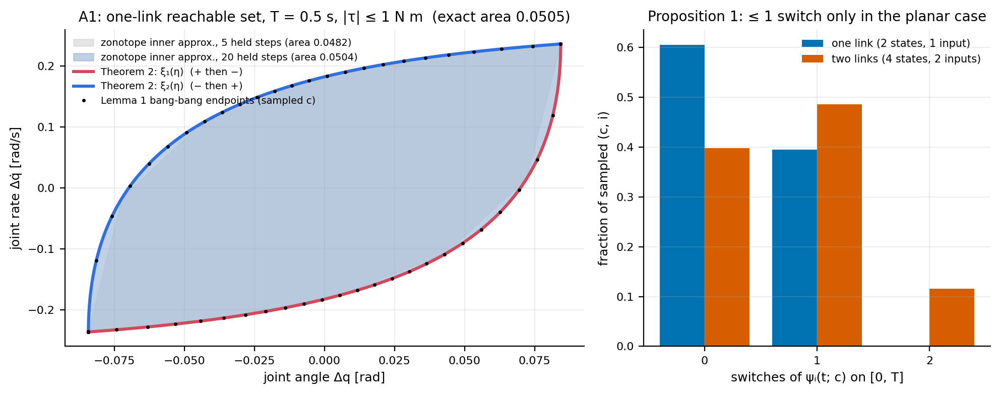
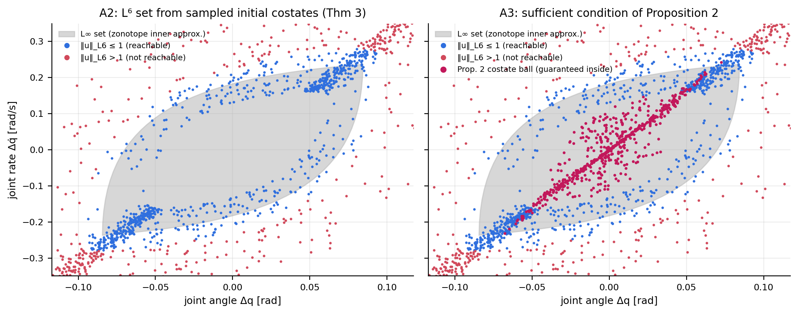
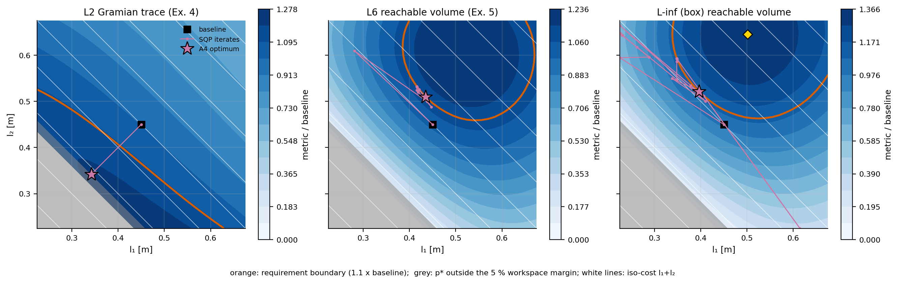
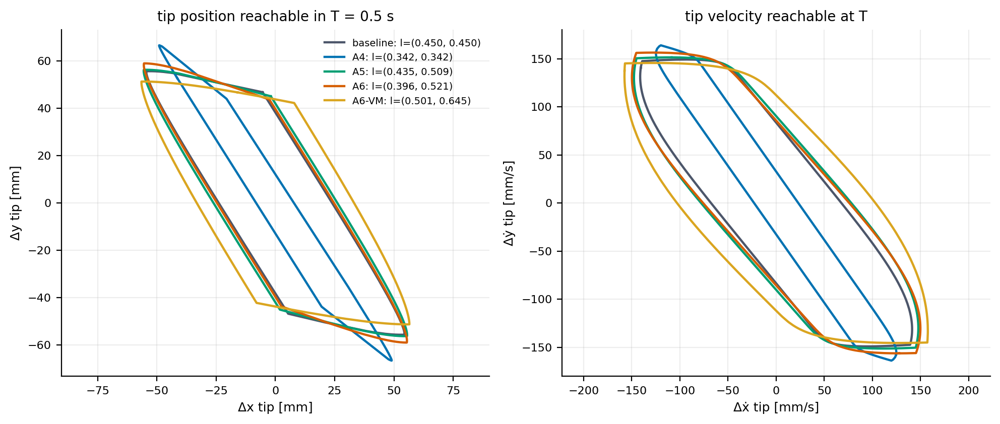
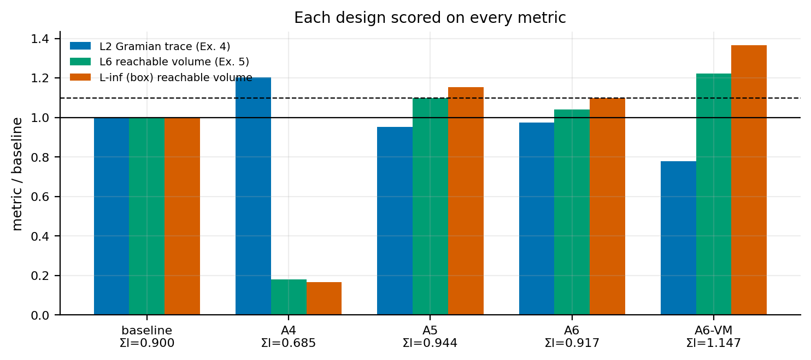
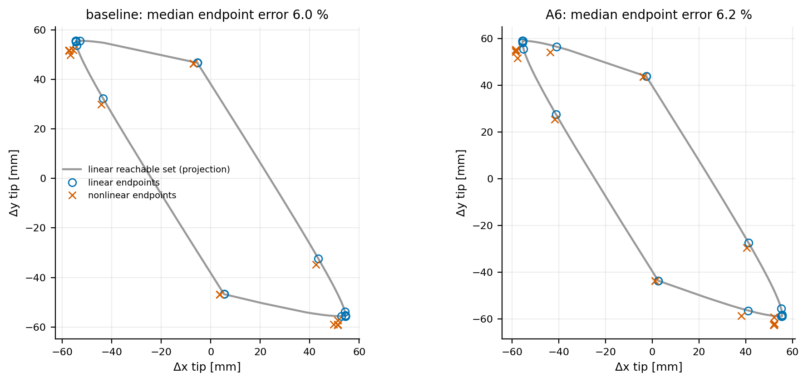

# Study A: Reachability analysis for morphology design

This study applies the method of **Nguyen, Cortés & Kramer, "Reachability
Analysis for Design Optimization", ACC 2026
([arXiv:2603.15865](https://arxiv.org/abs/2603.15865))** to the two-link arm in
[`common/arm.py`](../common/arm.py), which replaces the paper's F-16
longitudinal model. The follow-up paper (Nguyen, Orndorff, Cortés & Kramer,
[arXiv:2604.26134](https://arxiv.org/abs/2604.26134)) supplies the box-input
(bang-bang) volume metric and the "maximize volume" case.

> **Question.** Which link lengths (l₁, l₂) give the cheapest arm (least total
> link length) whose tool tip can reach at least **10 % more** of task space in
> T = 0.5 s than the baseline arm? The answer must not depend on which
> controller is later used.

The reachable set is the set of every state the actuators can produce within
the horizon. A design judged by it is **controller-agnostic**: the plant is
not tied to one controller or one trajectory, unlike a tracking-error design.

---

## 1. Mapping from the paper to the arm

| | Nguyen, Cortés & Kramer | This study |
|---|---|---|
| System | F-16 longitudinal dynamics, linearized at trim | 2-link horizontal (SCARA-type) arm, linearized at rest holding a tool at p\* = (0.55, 0.35) m |
| State (4) | v_T, α, q, θ | Δq₁, Δq₂, Δq̇₁, Δq̇₂ |
| Inputs (2) | throttle, elevator | shoulder, elbow torque (\|τ\| ≤ 1.0, 0.5 N·m) |
| Design variables (2) | span b, chord c̄ | link lengths l₁, l₂ |
| Design cost | b + c̄ | l₁ + l₂ |
| Bounds | 0.5–1.5 × baseline | 0.5–1.5 × baseline, plus p\* at least 5 % inside the workspace annulus |
| Requirement | metric ≥ 1.1 × baseline | same |
| Set measured | full state | task space y = [Δx_tip, Δy_tip, Δẋ_tip, Δẏ_tip] = blkdiag(J, J)·x |
| Planar Ex. 1–3 | 2-D toy matrix | one-link arm, state (Δq, Δq̇) |
| Horizon | T = 1 | T = 0.5 s (see §3) |
| Optimizer | pySLSQP | scipy SLSQP, finite differences, plus a dense-grid cross-check |

The set is measured in task space, not joint space, because joint-space sets
of arms with different lengths are not comparable. The task-space volume also
includes the Jacobian: a near-singular posture flattens the set. That
flattening is what makes the trace and volume metrics disagree (§4).

## 2. Method (implemented in [`reachability.py`](reachability.py))

Inputs are normalized, τ = diag(τ_max)·v, and the kernel is
`G(t) = C e^{A(T−t)} B diag(τ_max)`.

| Result (paper) | Statement | Use here |
|---|---|---|
| **Lemma 1** | Exposed points of the box-input set come from bang-bang inputs vᵢ(t) = sign ψᵢ(t; c), with ψ(t; c) = cᵀG(t) | sample costate directions c ∈ S³ (2048, Sobol); the convex hull of the endpoints is an **inner** approximation of the box-input (L∞) set |
| **Prop. 1** | Planar, single input, real distinct eigenvalues ⇒ at most one switch | checked numerically (A1); fails for the 4-state arm, which switches up to twice |
| **Theorem 2** | Exact boundary R = conv(ξ₁ ∪ ξ₂), with ξ₁,₂(η) the one-switch endpoints | one-link arm: A = [[0, 1], [0, −c/I]], eigenvalues 0 and −c/I, so the hypotheses hold |
| **Theorem 3** | L^p-optimal input v\*(t) = \|−Bᵀe^{−Aᵀt}λ₀\|^{1/(p−1)} sgn(·) | L⁶ set from sampled λ₀ (A2) and L⁶ volume (A5) |
| **Prop. 2** | ‖λ₀‖_q^q ≤ 1/(m∫‖vec(e^{−At}B)‖_p^q dt) ⇒ ‖v‖_{Lp} ≤ 1 | guaranteed-inside costate ball (A3) |
| L² Gramian | W = ∫G Gᵀ dt (ellipsoid of unit-energy inputs) | trace metric (A4) |
| Zonotope | piecewise-constant inputs give an exact zonotope ⊂ the true set | inner reference in A1–A3 (the paper used CORA) |

Three metrics are each optimized in its own run:
* `trace` = tr W (paper Ex. 4)
* `vol_l6` = 4-D hull volume of the L⁶ set (paper Ex. 5). The radius is
  (mT)^{1/6}, so the L⁶ ball contains the torque box.
* `vol_linf` = 4-D hull volume of the box-input set, i.e. the real torque
  limits (follow-up paper)

## 3. Why there is a trade-off, and the choice of T

The motors are geared, and their back-EMF acts as viscous damping
c = 4 N·m·s/rad. The time constant M/c splits the physics into two regimes:

* **short times:** motion is limited by inertia. Lighter, shorter links
  accelerate the tip faster.
* **longer times:** motion is limited by speed (q̇ ≤ τ/c). The tip speed is
  lever arm × q̇, so longer links move the tip further.

At T = 0.5 s the box-input volume therefore peaks at an **interior**
morphology. The baseline (0.45, 0.45) m lies on the short side of that peak.
Gaining 10 % reachability thus costs link length, as in the paper's aircraft,
where better maneuverability cost wing size.

**Exact time scaling.** If q_k solves Mq̈ + kc·q̇ = τ on [0, T/k], then
q(s) = k²q_k(s/k) solves Mq'' + c·q' = τ(s/k) on [0, T]. The box input set is
invariant under time rescaling, so going from (c, T) to (kc, T/k) scales every
design's position set by 1/k² and its velocity set by 1/k. **Volume ratios,
and so the A5/A6/VM designs, are exactly unchanged.** The trace is different:
it adds position and velocity variances, which scale differently, so its
ratios shift slightly (1.186 → 1.204 at the A4 design). The A4 design itself
does not move, because it sits on the workspace bound. The study uses
(c, T) = (4, 0.5) rather than (2, 1). The tip then moves about 5 cm instead of
20 cm, and the linearization error falls from about 24 % (measured at
(2, 1)) to the value reported in A7.

## 4. Experiments, figures and results

All numbers are from `results/summary.json`.

### A1: exact planar boundary (paper Ex. 1, Fig. 1)


One link, l = 0.9 m, |τ| ≤ 1 N·m, T = 0.5 s. A = [[0, 1], [0, −5.81]] has
real distinct eigenvalues {0, −5.81}, so Theorem 2 applies.

| Method | Area of R(T) in (Δq, Δq̇) |
|---|---|
| Theorem 2, conv(ξ₁ ∪ ξ₂) (exact) | 0.050494 |
| Lemma 1, 720 sampled bang-bang endpoints | 0.050488 |
| Zonotope inner approx., 20 held steps | 0.050352 |
| Zonotope inner approx., 5 held steps | 0.048219 |

The sampled extremals lie on the Theorem-2 curves, and the zonotopes converge
from inside. Right panel: every one-link switching function ψ(t; c) switches
at most once, as Proposition 1 says. For the two-link arm, 952 of 8192
sampled (c, i) pairs switch **twice**. The paper's warning that "the number of
switches can increase for higher-dimensional systems" is therefore real here,
and the 4-D sets must be computed by sampling, not by Theorem 2.

### A2, A3: L⁶ sets from costates (paper Ex. 2–3, Figs. 2–3)


1,525 initial costates λ₀ (as in the paper) produce Theorem-3 inputs. Blue
points have ‖u‖_{L⁶} ≤ 1 and red points do not. The L⁶ boundary hugs the L∞
set and bulges past it at the corners, so it is a tight **outer**
approximation of the box-input set, as the paper reports. Magenta points
come from the Proposition-2 costate ball (‖λ₀‖_q^q ≤ 0.1408). Their largest
L⁶ norm is 0.86 < 1, so they are guaranteed inside but conservative.

### A4–A6: design optimization (paper Ex. 4–5, follow-up paper)


| Design | Requirement | l₁, l₂ [m] | Σl (cost) | Cost change | trace | vol L⁶ | vol L∞ | Mass [kg] |
|---|---|---|---|---|---|---|---|---|
| baseline | — | 0.450, 0.450 | 0.900 | — | 1.00 | 1.00 | 1.00 | 2.45 |
| **A4** (Ex. 4) | tr W ≥ 1.1 tr W₀ | 0.342, 0.342 | 0.685 | **−23.9 %** | **1.20** | 0.18 | 0.17 | 2.02 |
| **A5** (Ex. 5) | vol L⁶ ≥ 1.1 | 0.435, 0.509 | 0.944 | **+4.9 %** | 0.95 | **1.10** | 1.15 | 2.54 |
| **A6** (box) | vol L∞ ≥ 1.1 | 0.396, 0.521 | 0.917 | **+1.9 %** | 0.98 | 1.04 | **1.10** | 2.49 |
| A6-VM | max vol L∞ | 0.501, 0.646 | 1.147 | +27.4 % | 0.78 | 1.22 | **1.37** | 2.94 |

Metrics are ratios to the baseline. Bold marks each design's own target
metric.

**Verification.** SLSQP converged in every case (2, 24, 42 and 7
iterations). Re-solving from the SQP point with derivative-free COBYLA gives
the same costs (0.6845, 0.9444, 0.9175) to four digits. The cheapest feasible
point on the 31×31 grid (15 mm spacing) costs 0.690, 0.945 and 0.930, never
less than the SQP optimum. The *location* is weakly determined along iso-cost
directions. The A4 optimum is not unique: the workspace-margin boundary
l₁ + l₂ = 1.05|p\*| is itself an iso-cost line, so any point of it with
enough trace is optimal. On the map above, each volume-design star sits where
an iso-cost line (white) touches the requirement contour (orange).




**What the cases show**

1. **The trace and volume metrics disagree completely, as in the paper.**
   Paper Ex. 4 (trace) and Ex. 5 (volume) produced very different wings. On
   the arm the disagreement is stronger. The trace requirement is met by
   *shrinking* the arm by 24 % until it hits the workspace margin: the
   posture nears the stretched singularity and the arm becomes very light.
   The trace rises by 20 %, but the 4-D L∞ volume collapses to 17 % of the
   baseline. The set becomes a thin sliver (A4 projections), with large
   reach along one direction and almost none across it. This is the
   "lopsided set" failure the paper attributes to aggregate metrics, which
   it proposes to fix with eccentricity constraints. The volume metrics
   detect the singularity, because det J enters the task-space volume. The
   trace is a sum of eigenvalues and does not.
2. **The volume requirements cost little, as in Ex. 5 (+0.8 %).** For +10 %
   volume, the cheapest arms lengthen the forearm and shorten or keep the
   upper arm: (0.396, 0.521) m for the box set at +1.9 % length, and
   (0.435, 0.509) m for L⁶ at +4.9 %. A longer distal link gains tip speed
   in the speed-limited regime. A light proximal link keeps the shoulder
   inertia low.
3. **L⁶ is a reasonable but imperfect proxy for L∞.** The L⁶ design gives
   +15 % box volume (more than needed) at 3 % more length than the direct L∞
   design. In the other direction, the L∞ design reaches only +4 % in L⁶.
   Since the true actuator limits are boxes, A6 (the follow-up paper's
   metric) is the physically relevant answer.
4. **There is an interior optimum (VM).** Volume maximization stops at
   (0.501, 0.646) m with +37 %. Beyond it, extra inertia outweighs extra
   lever. This is the follow-up paper's "VM" design: more capability for
   27 % more material.

### A7: nonlinear check


The 24 tip-plane bang-bang extremals were replayed on the full nonlinear arm
(rigid-body dynamics with Coriolis terms). The median endpoint error is
**6.0 % for the baseline and 6.2 % for A6**. The error is systematic (the
nonlinear endpoints are slightly inside the linear ones) and almost equal for
both designs, so the design *ratios* that drive the optimization are much more
accurate than 6 %.

## 5. Running

```bash
python study_A_reachability_design/run_study.py     # about 9 min on one core (the 31×31 grid dominates)
```

Settings are the constants at the top of [`run_study.py`](run_study.py):
horizon, baseline, bounds, required gain, p, number of directions, grid size.
Outputs go to `figures/` and `results/summary.json`.

## 6. Differences from the paper and limitations

* **No aircraft aerodynamics.** The dependence of (A, B) on the design comes
  from rigid-body mechanics, which the paper leaves implicit for the F-16.
* **Hull volumes are inner approximations** from 2048 costate directions.
  Ratios between designs converge faster than absolute volumes. Hull volumes
  are only piecewise smooth (facets switch as the design moves), which can
  make SLSQP chatter on an active volume constraint. Every SQP result is
  therefore re-solved with derivative-free COBYLA from the SQP point and
  cross-checked against a 31×31 grid.
* **Linear model.** The arm is linearized about the holding posture. A7
  quantifies the error on the nonlinear arm.
* **Controller-agnostic does not mean controller-free.** A large reachable set
  is necessary for agile control, not sufficient. Study B adds the closed loop
  and disturbances.
