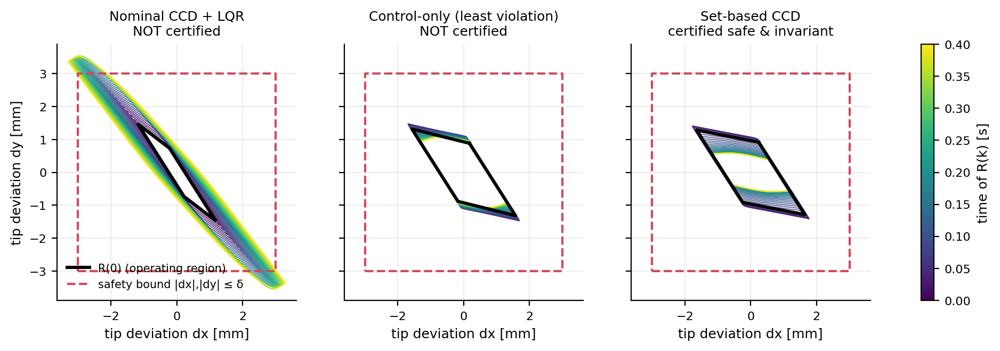
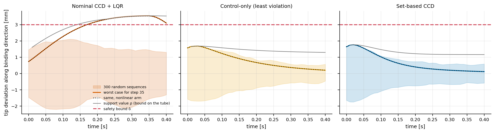

# Study B: Set-based robust control co-design

This study applies the method of **Bird, Siefert, Pangborn & Jain, "A Set-Based
Approach for Robust Control Co-Design", ACC 2024
([arXiv:2310.11658](https://arxiv.org/abs/2310.11658))** to the two-link arm in
[`common/arm.py`](../common/arm.py), which replaces the paper's quarter-car
active suspension.

> **Question.** The arm holds a tool at the work point p\* while unknown
> contact forces of up to ±0.3 N act on the tip. Which link lengths **and**
> state-feedback gains keep the tip within ±3 mm for **every** admissible force
> history and stay inside the motor torque limits, at the lowest cost?

Conventional co-design optimizes for one assumed scenario (one initial state
and one disturbance history). Set-based co-design propagates the whole set of
possible states through the closed loop and constrains that set. Its result is
a *certificate*: the design is safe for all time and for all disturbances in
the set.

---

## 1. Mapping from the paper to the arm

| | Bird et al. (2024) | This study |
|---|---|---|
| Plant | quarter-car active suspension | 2-link SCARA arm holding a tool at p\* = (0.55, 0.35) m |
| State x (4) | tire deflection, unsprung velocity, suspension stroke, sprung velocity | Δq₁, Δq₂, Δq̇₁, Δq̇₂ about the IK configuration q₀(l) |
| Disturbance set W | road velocity ż₀ ∈ [−0.2, 0.2] m/s | tip force F ∈ [−0.3, 0.3]² N, entering as Jᵀ(q₀)F |
| Plant design p_p | spring k_s, damper c_s | link lengths l₁, l₂ ∈ [0.3, 0.8] m |
| Controller p_c | u = p_cᵀx (4 gains) | τ = Kx, K ∈ ℝ^{2×4} (8 gains) |
| Safety set X̄ | \|z_s − z_us\| ≤ 0.5 m | \|Δx_tip\|, \|Δy_tip\| ≤ δ = 3 mm |
| Input set Ū | \|u\| ≤ 4000 N | \|τ₁\| ≤ 1.0 N·m, \|τ₂\| ≤ 0.5 N·m |
| Operating region R(0) | box | box: \|Δqᵢ\| ≤ 0.002 rad, \|Δq̇ᵢ\| ≤ 0.02 rad/s |
| Sampling, horizon | ZOH, Δt = 0.01 s, N = 20 | ZOH, Δt = 0.01 s, N = 40 (0.4 s) |
| Plant cost m_p | 10⁻²k_s + 10⁻¹c_s | (l₁ + l₂)/(l₁⁰ + l₂⁰) (material and size) |
| Solver | MATLAB fmincon (SQP) | scipy SLSQP, phase-1 start, 9-point multistart |
| Baseline | simultaneous CCD for one scenario, then LQR | same idea: lengths optimized for one force history with K = LQR(l) |

The disturbance is a force at the tool, mapped to joint torques through the
Jacobian. The link lengths therefore set three things at once: the moment arm
of the disturbance, the arm's inertia, and how joint errors become tip errors.
The work point is fixed, so the arm's posture q₀(l) also changes with the
lengths.

## 2. Method

### Closed-loop reachable sets (exact zonotopes)
With ZOH discretization (A_d, B_d, E_d) and u = Kx,

```
R(0)   = box (operating region)
R(k+1) = (A_d + B_d K) R(k)  ⊕  E_d W
U(k)   = K R(k)
```

The system is linear and every set is a zonotope ⟨c, G⟩, so the recursion is
**exact**. It needs no generator reduction and no template over-approximation;
after 40 steps there are 84 generators. Every support function is closed-form:

```
ρ_Z(ℓ) = ℓᵀc + ‖Gᵀℓ‖₁
```

### Proposition 1 (the certificate)
The paper's three groups of linear inequalities in support values:

| | condition | meaning |
|---|---|---|
| (23a) | ρ_{R(k)}(h_i) ≤ f_i, k = 1..N, rows of the safety polytope | tip stays within ±δ |
| (23b) | ρ_{U(k)}(±e_j) ≤ τ_max,j, **k = 0..N−1** | no torque saturation |
| (23c) | ρ_{R(N)}(±e_i) ≤ r0_i | R(N) ⊆ R(0) |

Together, (23a)–(23c) make the union R(0) ∪ … ∪ R(N−1) robustly positively
invariant. The tip therefore stays safe **forever**, even though only N steps
are computed. Note that the paper's Algorithm 1 starts the input sets at
k = 1, while Proposition 1 needs k = 0. This implementation checks k = 0 too.

### Problem (24)

```
min_{l, K}  m_p(l) + γ₁ R̄₂(Q R(N)) + Σ_k [ γ₂ R̄₂(Q R(k)) + γ₃ R̄₂(U(k)/τ_max) ]
s.t.        (23a), (23b), (23c),  workspace margin ≥ 5 %,  bounds on l and K
```

Here R̄₂(E) = ‖d(E)‖₂ + ‖c(E)‖₂ is the paper's radius bound (Eq. 21), built
from axis-aligned support values. Q maps the state to tip position/δ and tip
velocity/(0.05 m/s), and (γ₁, γ₂, γ₃) = (1, 0.05, 0.01). The paper writes the
support values as auxiliary equality-constrained variables. Here they are
evaluated inside the constraint functions (reduced-space form), which gives
the same feasible set. Gains are scaled internally (K_ij = z_ij τ_i / r0_j) so
that the SQP sees O(1) variables.

### Solution procedure
1. **Phase 1** maximizes the smallest normalized constraint slack. Its
   optimum s\* is a feasibility measure: s\* ≥ 0 means a certifiable design
   exists from this start.
2. **Problem (24)** is solved by SLSQP from the phase-1 point.
3. Multistart: 3 morphologies × 3 LQR weightings. The best certified design
   is kept.

### The three designs compared
| Design | What is optimized | Analogue in the paper |
|---|---|---|
| **Nominal CCD + LQR** | l minimizes m_p + quadratic cost of **one** force history, K = LQR(l) with the same weights | "Simultaneous" design (Table I) |
| **Control-only set-based** | K only, on the baseline l = (0.45, 0.45) m | not in the paper; isolates the value of changing the morphology |
| **Set-based CCD** | l and K together, Problem (24) | the paper's method |

## 3. Figures

| File | Content | Paper analogue |
|---|---|---|
| `B1_reachable_tubes_tip.png` | R(0..N) projected on the tip deviation (Δx, Δy); safety box dashed, R(0) bold | Fig. 3(a)/(b) |
| `B2_constraint_usage.png` | support value / limit along the horizon for safety, torque and terminal containment | (the paper's Prop. 1) |
| `B3_nominal_scenario.png` | tip deviation and torques under the one scenario the baseline was designed for | Fig. 4(a)/(b) |
| `B4_worst_case_validation.png` | the worst-case force history (a bang-bang sequence that attains the support value), 300 random sequences, and the same worst case on the **nonlinear** arm | not in the paper |
| `B5_morphologies.png` | the three arms holding the tool at p\* | — |
| `B6_convergence.png` | SQP history of the best start | — |

The worst-case history is computed exactly. Since x(k\*) is linear in the
initial state and the forces, the maximizer of hᵀx(k\*) is
F_j = F_max·sign(E_dᵀ(A_clᵀ)^{k\*−1−j}h) together with a vertex of R(0). B4
therefore realizes the support function as an actual trajectory. This is how
the robustness claim is checked by simulation rather than taken on faith.

## 4. Results

Values are from `results/summary.json`. Usage = worst support value / limit;
a usage ≤ 1 in all three columns is the certificate.

| Design | l₁, l₂ [m] | Σl vs baseline | Objective (24a) | Safety usage (worst tip error) | Torque usage | R(N) ⊆ R(0) usage | Certified |
|---|---|---|---|---|---|---|---|
| Nominal CCD + LQR | 0.385, 0.300 | −24 % | 5.73 | **1.18** (3.54 mm) | 0.31 | **4.75** | **no** |
| Control-only set-based (best of 3 starts) | 0.450, 0.450 | 0 % | 3.36 | 0.56 (1.69 mm) | **1.01** | **1.05** | **no** (max slack −0.053) |
| **Set-based CCD** | **0.472, 0.481** | **+6 %** | **3.15** | 0.59 (1.77 mm) | 1.00 (active) | 1.00 (active) | **yes** |



**1. The nominal design is safe only for its scenario.** It is optimized for
one force history (B3), which it handles easily: peak tip error 0.81 mm using
under 10 % of the torque limits. (The set-based design's peak in that
scenario is 0.24 mm.) Its lengths go to the shortest admissible arm (5 % workspace
margin), because that is cheapest and the scenario never penalizes it. Over
the full set W its tube leaves the ±3 mm box (B1, left), and R(N) is 4.75×
too large to be re-contained in R(0). This is the result of the paper's
Fig. 3(b), reproduced on the arm.



**2. Random testing would not have found the violation.** B4 realizes the
worst-case force sequence for the binding direction. It drives the nominal
design to 3.54 mm (3.53 mm on the nonlinear arm), exactly the support value.
Meanwhile, 300 random ±F_max sequences from random vertices of R(0) never
exceed 2.11 mm. A Monte-Carlo campaign of this size would have declared the
design safe. Set-based analysis finds the worst case by construction.

**3. The controller alone cannot fix the baseline morphology.** With the
baseline lengths fixed, the best gain found (phase 1, 3 starts) still
violates the torque and terminal conditions (worst slack −0.053). With fixed
0.45/0.45 m links, rejecting 0.3 N within the R(0) box needs more torque than
the motors have.

**4. Co-design makes certification possible at small cost.** Lengthening
both links slightly (+6 % material) and re-tuning K gives a certified design
(slack ≥ 0 everywhere). Its tube stays inside R(0)'s image and inside ±1.77 mm
(B1, right). The torque and invariance constraints are active, as the 4000 N
input limit was in the paper's Table I. In the cheapest certified design,
safety is not the binding constraint: torque saturation and re-entry into
R(0) are. Its objective (3.15) is also below the infeasible control-only
design (3.36).

**5. Linearization.** Over these millimetre motions the nonlinear arm with
sampled feedback follows the linear worst case to within 0.02 mm (B4, dotted).

Gains (u = Kx, x = [Δq₁, Δq₂, Δq̇₁, Δq̇₂], SI units):

| Design | K |
|---|---|
| Nominal CCD + LQR | [[−44.9, −17.4, −3.3, −0.9], [−6.0, −6.3, −0.5, −0.1]] |
| Set-based CCD | [[−197.2, −69.0, −14.0, −9.4], [−36.1, −75.5, −3.4, −10.5]] |

As in the paper ("a more aggressive feedback gain"), the robust design uses
higher gains. The input constraint is what limits them.

**Multistart.** All 9 co-design starts reached a certified point (phase-1
slack ≈ +0.065). SLSQP then converged to two local optima, J = 3.15 (2
starts) and J ≈ 3.81 (7 starts). The best one is reported, and the full log is
in `summary.json`.

## 5. Running

```bash
python study_B_set_based_ccd/run_study.py     # about 6 min on one core
```

All settings live in the `Setup` dataclass at the top of
[`setbased.py`](setbased.py): disturbance size, tolerance, R(0), horizon,
bounds, weights. The scenario and LQR weights are at the top of
[`run_study.py`](run_study.py). Outputs go to `figures/` and
`results/summary.json`, which includes the per-start multistart log.

## 6. Differences from the paper and limitations

* **Plant variables are geometric.** Link lengths change inertia, the
  Jacobian and the posture together, so the design enters A, B and E
  nonlinearly. The suspension's k_s and c_s enter linearly.
* **The sets are exact, not templates.** The linear discrete system allows
  exact zonotopes. The paper's template machinery is needed only for nonlinear
  or non-zonotopic cases.
* **Disturbances are held constant over each 0.01 s sample (ZOH).** The
  certificate is exact for that disturbance class. Continuous-time
  disturbances between samples are not covered.
* **The linear model** holds for small deviations. B4 compares the worst case
  with the nonlinear arm, and over millimetre-scale motions they agree to
  plotting accuracy.
* **Local optimizer.** The support functions are piecewise smooth (they are
  1-norms), and SLSQP uses finite differences. Different starts converge to
  different local optima, so the multistart log is reported. The certificate
  of the chosen design is exact whatever the optimizer's optimality.
* **R(0) and N are fixed by the designer**, as in the paper (Remark 6).
  Condition (23c) is sufficient for invariance, not necessary.
